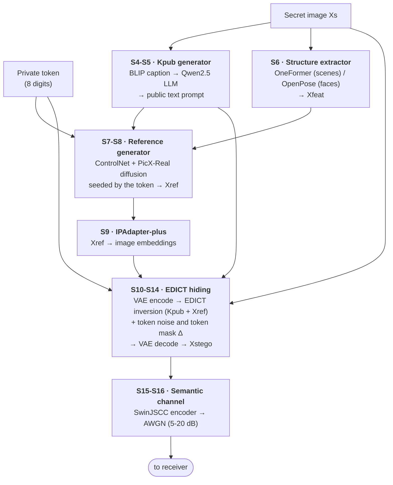
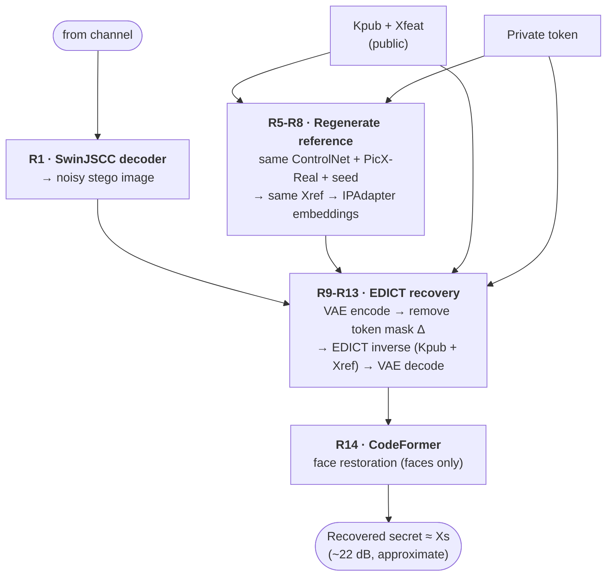

# Baseline: AgentSemSteCom

**Paper**: Meng et al., *Agentic AI-enabled Semantic Steganographic Communication*, IEEE TCCN 12, 2026.
**Our code**: `pipelines/agentsemstecom.py` · run with `scripts/run_baseline.py`.

## 1. What it does

It hides a **secret image** inside a different-looking **stego image**, sends that over a
noisy wireless channel, and lets only the receiver holding the **private token** recover the
secret. It is steganography (hiding that a secret exists), not classic encryption: the token
acts as the key, and a wrong token gives a garbled image.

Three kinds of information are involved:

| Name | Who has it | What it is |
| :-- | :-- | :-- |
| `Kpub` (public key) | Sender and receiver | A text prompt describing the image, written by an LLM |
| `Xfeat` (implicit feature) | Sender and receiver | Structure of the secret: a segmentation map or a pose skeleton |
| Token (private key) | Sender and receiver only | An 8-digit number that seeds the secret perturbation |

## 2. Sender: hiding (the "encryption" side)

```
Secret Xs
  ├─ BLIP caption → Qwen2.5 LLM ──────────────► Kpub (public text prompt)
  ├─ OneFormer (scenes) / OpenPose (faces) ───► Xfeat (structure)
  │
  │  token → seed
  ▼
PicX-Real (Stable Diffusion) + ControlNet(Xfeat) + Kpub ──► Xref (reference image)
  │
  ▼
EDICT inversion of Xs  (exactly invertible diffusion, prompt = Kpub,
                        IPAdapter injects Xref, strength 0.2, 20 steps)
  │  + token-derived noise and a sparse token mask (delta) on the latent
  ▼
Stego image Xstego   (looks like Xs re-rendered toward Xref)
  │
  ▼
SwinJSCC encoder (learned semantic codec, C = 64) ──► AWGN channel (5–20 dB SNR)
```

## 3. Receiver: recovery (the "decryption" side)

```
Received signal ──► SwinJSCC decoder ──► noisy stego
  │
  │  same Kpub, same Xfeat, same token  ⇒  same Xref regenerated
  ▼
remove token mask (delta) → EDICT inverse (IPAdapter with Xref, prompt Kpub)
  │
  ▼
Recovered secret ──► CodeFormer face restoration (faces only, fidelity 0.5)
```

Security rests on the token: it seeds the reference image, the noise and the mask. A wrong
token or no token reverses the wrong perturbation, so the secret does not come back.

## 3a. Block diagrams

### Sender — hiding ("encryption")



### Receiver — recovery ("decryption")



### Block reference

| Block | Component | Input → output | Why it is there |
| :-- | :-- | :-- | :-- |
| S1 | Secret image | photo → 256×256 RGB | What must be delivered secretly |
| S2/R4 | Private token | 8-digit string | The only secret the two sides share; everything private derives from it |
| S3/R5 | SHA-256 derivation | token → integer seeds | Makes every random choice reproducible at both ends, without Python's random `hash()` |
| S4 | BLIP | image → caption | Perception step: what is in the image |
| S5/R2 | Qwen2.5 LLM | caption → Kpub | "Agentic" step: turns perception into a public generation prompt |
| S6/R3 | OneFormer / OpenPose | image → Xfeat | Keeps the secret's layout or pose in the reference |
| S7/R6 | ControlNet | Xfeat → spatial conditioning | Forces the generated reference to follow Xfeat |
| S8/R7 | PicX-Real (SD v1.5) | Kpub + Xfeat + seed → Xref | The reference image both ends regenerate identically |
| S9/R8 | IPAdapter-plus | Xref → image embeddings | Makes the stego depend on the reference's pixels |
| S10/R9 | SD VAE encoder | pixels → latent | Diffusion works in latent space |
| S11/R11 | Token noise | token → Gaussian tensor | Keyed noise inside the inversion |
| S12/R12 | EDICT | latent ↔ hidden latent | Exactly invertible diffusion: the receiver can undo the sender's steps |
| S13/R10 | Token mask Δ | token → sparse perturbation | Without the right token the receiver subtracts the wrong Δ and recovery fails |
| S14/R13 | SD VAE decoder | latent → pixels | Produces the stego image and the recovered image |
| S15/R1 | SwinJSCC | image ↔ channel symbols | Learned semantic codec: sends meaning, not bits |
| S16 | AWGN channel | symbols + noise | Simulated wireless link at a chosen SNR |
| R14 | CodeFormer | face → restored face | Repairs the face detail lost in the round trip |
| R15 | Metrics | recovered vs secret | Quality, security gap and detectability (section 4) |

**Approximate by design.** Two blocks lose information: the VAE (S10/S14/R9/R13 is not
lossless) and the noisy channel (S15-S16, R1). That is why the baseline recovers about
22 dB instead of an exact copy, the gap our Contribution 2 closes.

## 4. Metrics and what they mean

| Metric | Measures | Better | Rough reading |
| :-- | :-- | :-- | :-- |
| **PSNR** (dB) | Pixel error between secret and recovered image | Higher | under 15 garbled · 20–25 recognisable · over 30 near perfect |
| **SSIM** (0–1) | Structural similarity (edges, layout, contrast) | Higher | 1 = identical |
| **MSE** | Mean squared pixel error | Lower | 0 = identical |
| **LPIPS** (0–1) | Perceptual difference judged by a neural network | Lower | under 0.2 looks close to a human |
| **Correct − wrong gap** (dB) | Security: PSNR with the right token minus PSNR with a wrong token | Higher | bigger means a wrong key reveals less |
| **XuNet accuracy** | Can a CNN tell stego images from clean ones? | ~0.5 | 0.5 = coin toss = undetectable |
| **SNR** (dB) | Channel quality (input, not a score) | — | 5 = very noisy · 20 = clean |

## 5. Results

### Recovery quality, paper stack (ours: 2 test images per class, 24 cases)

| Class | SNR 5 dB | 10 dB | 15 dB | 20 dB |
| :-- | --: | --: | --: | --: |
| Common (scenes) — PSNR | 18.30 | 20.72 | 21.53 | 21.45 |
| Facial — PSNR | 22.56 | 24.54 | 24.89 | 25.10 |
| Style (art) — PSNR | 19.93 | 22.68 | 23.28 | 23.43 |
| Facial — SSIM / LPIPS | 0.60 / 0.23 | 0.69 / 0.16 | 0.71 / 0.15 | 0.72 / 0.14 |

Quality rises with SNR and flattens above 15 dB, where the channel stops being the
bottleneck and the diffusion round trip limits quality. Faces score highest because
CodeFormer restores them.

### Security and detectability (10 dB)

| | Ours | Paper (approximate) |
| :-- | --: | --: |
| Correct token PSNR | 22.37 dB | 25.37 dB |
| Wrong token PSNR | 13.96 dB | 18.91 dB |
| No token PSNR | 14.02 dB | — |
| **Correct − wrong gap** | **8.41 dB** | 6.46 dB |
| XuNet detection accuracy | 0.500 (n = 8) | 0.509 |

Our absolute PSNR is about 3 dB below the paper's, but the security gap is larger: a wrong
key reveals less than in the paper. XuNet is at chance, so the stego images are not
detectable by that network.

### Paper Table II anchors (selected)

| Class / SNR | Paper | Meaning |
| :-- | :-- | :-- |
| Facial 5 dB | PSNR 22.73, SSIM 0.699 | ours 22.56 / 0.60: close on PSNR |
| Facial 20 dB | PSNR 26.29, LPIPS 0.213 | ours 25.10 / 0.14: better LPIPS |
| Common 5 dB | PSNR 19.71, MSE 0.0121 | ours 18.30 |
| Style 5 dB | MSE 0.0072, LPIPS 0.385 | ours LPIPS 0.345 |

## 6. Where we differ from the paper (full list: `docs/DEVIATIONS.md`)

- **Hardware limits**: EDICT runs 20 steps at strength 0.2 and 256 px on a 6 GB GPU; the
  paper uses 50 steps at 0.5.
- **Codec**: SwinJSCC uses C = 64 (the nearest public checkpoint to the paper's C = 48),
  trained on DIV2K rather than CelebA-HQ.
- **Not reproduced**: the paper's digital MDJCM branch has no public checkpoint, so only
  the analog branch is run.
- **Sample size**: our numbers come from 2 images per class. A full 22-per-class run is
  `scripts/run_baseline.py --mode paper --from-phase 15 --to-phase 16 --yes --resume yes`
  (about 4–5 h).
- **Contamination**: one "style" test image (`eva_style_0011`) is actually a human portrait.

## 7. Weaknesses we address

| Weakness | Our fix |
| :-- | :-- |
| A new diffusion reference per message (3.9 s, 2.6 GB GPU) | **RACS**: retrieve the reference (0.05 s, no GPU), same quality |
| Recovery is only approximate (~22 dB, faces distorted) | **Contribution 2**: an exact-recovery layer, 66/66 pixel-identical |

## 8. Commands

```powershell
.venv\Scripts\python.exe scripts\run_baseline.py --show                     # print these results
.venv\Scripts\python.exe scripts\baseline_example.py --mode paper --image-id eva_facial_0000 --class facial --snr 10
```
