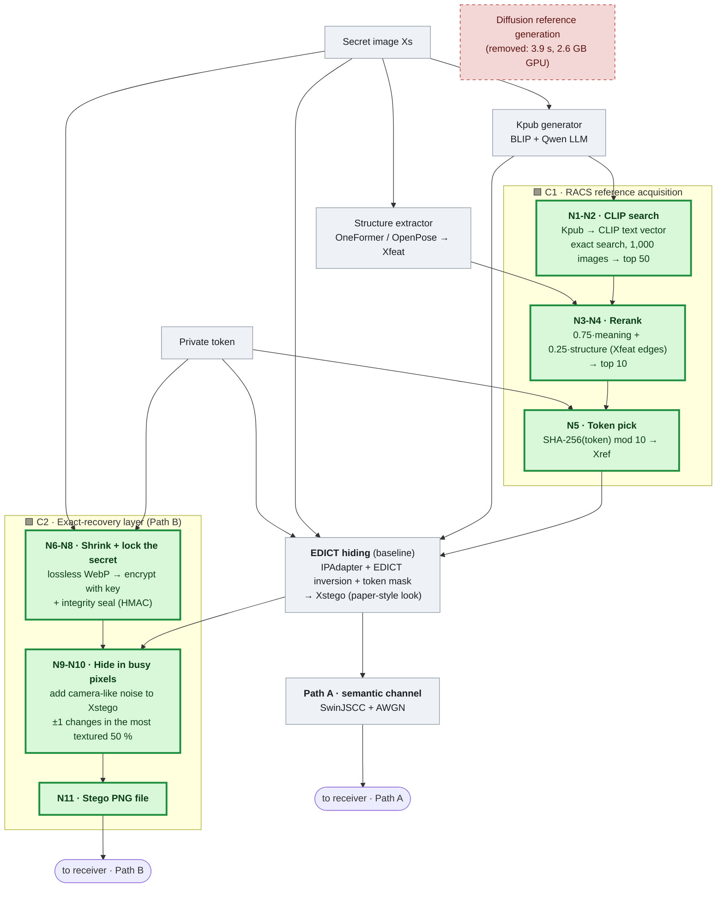
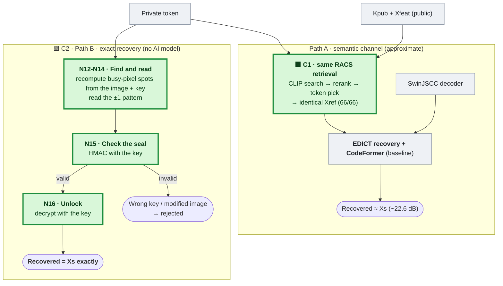

# Our System: RACS + Exact Recovery

**Built on**: AgentSemSteCom (Meng et al., IEEE TCCN 2026), described in `baseline.md`.
**Code**: `retrieval/racs.py`, `pipelines/racs_base.py`, `app/lossless.py`, `app/server.py`.

> **Legend**: 🟩 **NEW** = our contribution · ⬜ unchanged baseline block · 🟥 removed baseline block

## 1. What we changed, in one paragraph

The baseline **generates** its reference image with diffusion for every message and can only
**approximately** recover the secret. We made two contributions:

| # | Contribution | Replaces / adds | Main effect |
| :-- | :-- | :-- | :-- |
| **C1** | **RACS: retrieval-based reference acquisition** | Replaces ControlNet + PicX-Real generation (S7-S8) with CLIP retrieval, structural reranking and token selection | Reference in **0.048 s instead of 3.92 s (82× faster)**, **no GPU memory**, same quality and security |
| **C2** | **Exact-recovery layer** | Adds a keyed, authenticated, texture-adaptive carrier around the generative stego | Secret recovered **pixel-identical (66/66)** instead of ~22 dB; wrong keys **rejected**; chi-square detection at **chance** |

Everything else (Kpub LLM, Xfeat, EDICT, IPAdapter, SwinJSCC, CodeFormer) is the baseline's
own code, **imported, not copied** (`RACSBase` subclasses `Baseline` and overrides one method).

## 2. Sender — hiding ("encryption")



## 3. Receiver — recovery ("decryption")



## 4. New-block reference

| Block | Contribution | What it does | Design choice and why |
| :-- | :-- | :-- | :-- |
| **N1** | C1 | CLIP ViT-B/32 text embedding of Kpub | Query from **public** data only, so the receiver can recompute it without the secret |
| **N2** | C1 | Exact inner-product search, top-50 pool | Exact search (no approximate index) so sender and receiver get identical rankings |
| **N3** | C1 | Edge-map structural score | CLIP finds the right content but not the right layout; Xfeat is the only public structure both sides hold |
| **N4** | C1 | 0.75·semantic + 0.25·structural rerank, top 10 | Weights chosen on calibration images only; reranking a wider pool changes *which* images the token can pick |
| **N5** | C1 | SHA-256(token) mod K selection | One implementation used by both ends; 1/K guessing bound; never Python's `hash()` |
| **N6** | C2 | Lossless WebP compaction | 32 % smaller payload, which is what makes a low embedding rate affordable |
| **N7** | C2 | PBKDF2 key derivation | Slows brute force of the short numeric token |
| **N8/N16** | C2 | Stream encryption | Hidden bits look random |
| **N8/N15** | C2 | HMAC-SHA256 authentication | A wrong key or a modified image is *detected and rejected*, never shown as a wrong image |
| **N9** | C2 | Carrier upscale + σ = 1 dither | An upscaled image has an unnaturally clean LSB plane; dither makes it look like a camera photo |
| **N10/N13** | C2 | Texture-adaptive ±1 embedding | Changes only busy regions; ±1 instead of bit overwrite defeats the chi-square attack; receiver recomputes positions with no side information |
| **N11/N12** | C2 | PNG file transfer | Lossless; recompression would destroy the payload (and is detected) |

## 5. Metrics (same as the baseline, plus two)

| Metric | Measures | Better |
| :-- | :-- | :-- |
| PSNR / SSIM / MSE / LPIPS | Recovered vs secret image quality | PSNR, SSIM high · MSE, LPIPS low |
| Correct − wrong gap (dB) | Security: what a wrong key reveals | Higher |
| **Reference latency (s) / VRAM (GB)** | **Cost of obtaining Xref (C1)** | Lower |
| **Pixel-exact rate** | **Share of secrets recovered identically (C2)** | 100 % |
| **Detector AUC** | **Can chi-square / SPA tell stego from a clean carrier? (C2)** | 0.5 = cannot tell |

## 6. Results

### C1 — RACS vs baseline (same 6 evaluation images × 4 SNRs, same code path)

| Metric | Baseline (generation) | **RACS (retrieval)** | Change |
| :-- | --: | --: | :-- |
| Reference acquisition time | 3.92 s | **0.048 s** (0.51 s with image load) | **82× faster** |
| Reference GPU memory | 2.61 GB | **0 GB** | **no GPU needed** |
| Recovery PSNR | 22.37 dB | **22.62 dB** | +0.25 dB (paired) |
| SSIM | 0.616 | **0.627** | better |
| LPIPS | 0.238 | **0.227** | better |
| Security gap (correct − wrong, 10 dB) | 8.67 dB | **8.94 dB** | better |
| Xref sender = receiver | — | **66/66 bit-identical** | protocol holds |

| Retrieval phase | Gate result |
| :-- | :-- |
| 17 Exact retrieval | self-query top-1 = 1.0; faiss index agrees with in-process search |
| 18 Token selection | cross-process identical; near-uniform over K = 10 |
| 19 Structure cache | 1,000 rows, deterministic; 5 CLIP-vs-structure disagreements found |
| 20 Rerank | α = 0.75, β = 0.25 from a calibration sweep; reranking changes the pool for 67 % of images |

### C2 — Exact-recovery layer (all 66 evaluation secrets)

| Layer | Pixel-exact | Wrong key rejected | Payload | Bits/value | PSNR vs carrier | Chi-square AUC | SPA AUC |
| :-- | --: | --: | --: | --: | --: | --: | --: |
| Generative only (baseline) | **0 %** (~22.4 dB) | — | — | — | — | — | — |
| A · naive 2-LSB | 100 % | 100 % | 386 KB | 2.00 | 44.1 dB | 1.00 | 1.00 |
| B · + compaction | 100 % | 100 % | 261 KB | 2.00 | 44.1 dB | 1.00 | 1.00 |
| C · + adaptive ±1 | 100 % | 100 % | 261 KB | 0.25 | 57.2 dB | **0.50** | 1.00 |
| **D · + dithered carrier (ours)** | **100 %** | **100 %** | **261 KB** | **0.25** | **57.2 dB** | **0.50** | **0.83** |

**Reading it**: every layer recovers exactly; the contribution is making that *hard to
detect*. Adaptive ±1 drives chi-square to chance. SPA is weakened (1.00 → 0.83) but not
defeated, and without the dither it stays at 1.00, so how the carrier is made matters as much
as how the bits are hidden.

### Phone app (hybrid mode, one 902×1600 photo)

| Step | Time |
| :-- | --: |
| Kpub (BLIP + LLM, CPU) | ~20 s |
| **RACS reference acquisition** | **0.51 s** |
| EDICT stego look (strength 0.5, 512 px) | ~21 s |
| **Encrypt + embed** | **~0.7-2.5 s** |
| **Receive (extract + verify + decrypt)** | **~1-2 s, no AI model** |
| Result | **byte/pixel-identical secret; wrong key rejected** |

## 7. Honest limitations

- C1 quality numbers come from **6 evaluation images** (2 per class); the 66-image run is
  `scripts\phase21_racs.py --limit 0` (~2 h). The Tx = Rx invariant is checked on all 66.
- C2 is fragile by design: a messenger that recompresses photos destroys the payload. The
  receiver detects this; the stego must be sent as a file.
- C2 detectability is measured with classical detectors only; a trained CNN steganalyser
  (e.g. SRNet) is future work. The 8-digit token is short.
- The baseline itself is only partly rebuilt on the paper stack (see `baseline.md` §6).

## 8. Commands

```powershell
.venv\Scripts\python.exe scripts\phase17_20_racs.py          # C1: build + verify retrieval stack (~2 min)
.venv\Scripts\python.exe scripts\phase21_racs.py --limit 2   # C1: RACS end to end (~10 min)
.venv\Scripts\python.exe scripts\phase22_compare.py          # C1: comparison table
.venv\Scripts\python.exe scripts\c2_make_covers.py           # C2: generative carriers (~10 min)
.venv\Scripts\python.exe scripts\c2_evaluate.py              # C2: evaluation (~12 min)
.venv\Scripts\python.exe app\server.py                       # phone app (both contributions)
```

Details: `docs/CONTRIBUTION_2.md`, `docs/DEVIATIONS.md`, `experiments/results/phase22_comparison.md`,
`experiments/results/c2_exact_recovery.md`.
